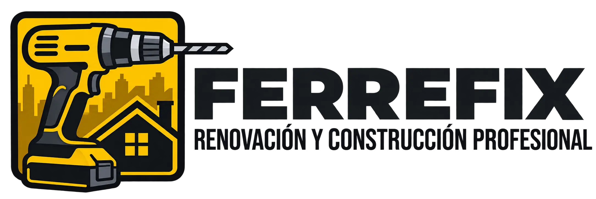

# Ferrefix

Interfaz web moderna y responsiva para una tienda de ferretería y herramientas, diseñada para ofrecer una navegación fluida, visualización clara de especificaciones técnicas y una experiencia de usuario sencilla en dispositivos móviles y escritorio.

## Tecnologías utilizadas

* **React + Vite:** Biblioteca principal para la construcción de la interfaz de usuario en JavaScript con empaquetado rápido.
* **React-Bootstrap & Bootstrap 5:** Framework y aplicación de propiedades de responsividad.
* **React Router DOM:** Gestión de rutas (Links) y navegación declarativa entre vistas (`BrowserRouter`, `Routes`, `Link`).
* **Axios:** Cliente HTTP para el consumo de APIs REST, gestión de catálogo, filtros y estado del carrito.
* **Vitest:** Entorno de pruebas unitarias y de integración para validar componentes, utilidades y lógica de negocio.
* **Bootstrap Icons:** Iconografía ligera.

## 📁 Estructura del proyecto

```text
src/
├── __tests__/     # Pruebas unitarias y de componentes con Vitest
├── assets/        # Imágenes estáticas, íconos y recursos gráficos
├── components/    # Componentes reutilizables (ProductCard, Navbar, Footer)
├── data/          # Acceso a los Datos y lógica general
├── pages/         # Vistas principales enrutadas con React Router DOM
├── services/      # Configuración de Axios y consumo de endpoints
├── utils/         # Funciones auxiliares
├── App.jsx        # Componente raíz y definición de rutas
├── index.css      # Estilos globales y ajustes personalizados
└── main.jsx       # Punto de entrada de la aplicación React